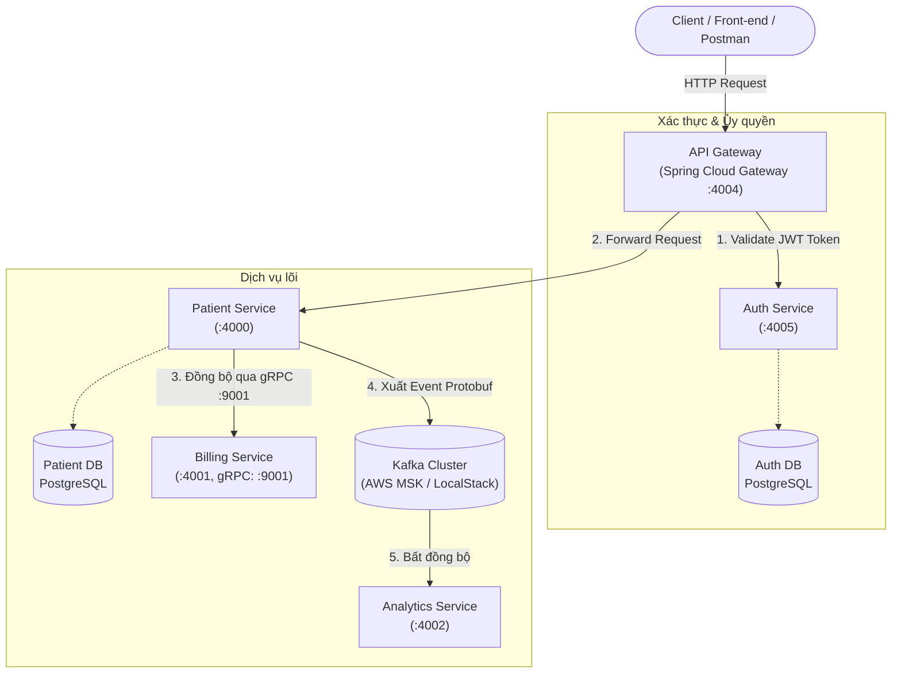

# 🏥 Patient Management System (Enterprise Microservices Simulation)

> Một hệ thống quản lý bệnh nhân theo kiến trúc **Enterprise Microservices** phân tán, tích hợp giao tiếp đồng bộ (**gRPC / REST**) và bất đồng bộ (**Apache Kafka / Protobuf**), bảo mật qua **API Gateway (JWT)**, và mô phỏng triển khai hạ tầng điện toán đám mây **AWS (ECS Fargate, RDS PostgreSQL, MSK Kafka, ALB)** bằng **AWS CDK** trên **LocalStack**.

---

## 📑 Mục lục
- [1. Tổng quan kiến trúc hệ thống](#1-tổng-quan-kiến-trúc-hệ-thống)
- [2. Ngăn xếp công nghệ (Tech Stack)](#2-ngăn-xếp-công-nghệ-tech-stack)
- [3. Danh mục Microservices & Cổng kết nối](#3-danh-mục-microservices--cổng-kết-nối)
- [4. Luồng xử lý dữ liệu (Workflow & Communication)](#4-luồng-xử-lý-dữ-liệu-workflow--communication)
- [5. Cấu trúc thư mục dự án](#5-cấu-trúc-thư-mục-dự-án)
- [6. Mô phỏng hạ tầng AWS với AWS CDK & LocalStack](#6-mô-phỏng-hạ-tầng-aws-với-aws-cdk--localstack)
- [7. Hướng dẫn cài đặt và khởi chạy](#7-hướng-dẫn-cài-đặt-và-khởi-chạy)
- [8. Kiểm thử & API Testing](#8-kiểm-thử--api-testing)

---

## 1. Tổng quan kiến trúc hệ thống

Dự án áp dụng mô hình phân rã dịch vụ (**Domain-Driven Microservices Design**) với các dịch vụ độc lập, tương tác với nhau thông qua mạng nội bộ:



---

## 2. Ngăn xếp công nghệ (Tech Stack)

| Hạng mục | Công nghệ sử dụng | Ghi chú |
| :--- | :--- | :--- |
| **Ngôn ngữ & Nền tảng** | **Java 25**, **Spring Boot 4.x / 3.x** | Mã nguồn hiện đại, tối ưu hiệu năng |
| **API Gateway** | **Spring Cloud Gateway** (WebFlux) | Định tuyến, cân bằng tải, custom `JwtValidationGatewayFilter` |
| **Bảo mật (Security)** | **Spring Security**, **JWT (jjwt)** | Xác thực không lưu trạng thái (Stateless Authentication) |
| **Giao tiếp đồng bộ** | **gRPC**, **Protocol Buffers (Protobuf)** | Kết nối hiệu năng cao, binary payload giữa Patient & Billing |
| **Giao tiếp bất đồng bộ** | **Apache Kafka**, **Spring Kafka** | Event-driven architecture, schema hóa sự kiện bằng Protobuf |
| **Cơ sở dữ liệu** | **PostgreSQL 17**, **H2 Database** (local), **Spring Data JPA** | Quản lý dữ liệu bệnh nhân và tài khoản xác thực |
| **Đám mây & Hạ tầng (IaC)**| **AWS CDK (Java)**, **LocalStack** | Triển khai VPC, ECS Fargate, MSK, RDS, ALB, CloudWatch |
| **Đóng gói container** | **Docker** (Multi-stage builds) | Tối ưu hóa dung lượng image với `eclipse-temurin` |
| **Kiểm thử & Tài liệu** | **REST-Assured**, **JUnit 5**, **SpringDoc OpenAPI (Swagger)** | Kiểm thử tích hợp và tài liệu hóa endpoint |

---

## 3. Danh mục Microservices & Cổng kết nối

| Service | Port | Giao thức | Trách nhiệm chính |
| :--- | :---: | :---: | :--- |
| **`api-gateway`** | `4004` | HTTP / REST | Cổng trung tâm duy nhất tiếp nhận request từ client, lọc và kiểm tra token JWT trước khi chuyển hướng đến các service nội bộ. |
| **`auth-service`** | `4005` | HTTP / REST | Quản lý người dùng hệ thống, cấp phát token JWT qua `/login` và kiểm tra tính hợp lệ của token qua `/validate`. |
| **`patient-service`** | `4000` | HTTP / REST & gRPC Client | Quản lý hồ sơ bệnh nhân (CRUD). Giao tiếp đồng bộ với Billing Service qua gRPC và gửi event tới Kafka. |
| **`billing-service`** | `4001`<br>`9001` | HTTP (Web)<br>gRPC (Server) | Tiếp nhận yêu cầu mở tài khoản thanh toán cho bệnh nhân mới thông qua rpc method `CreateBillingAccount`. |
| **`analytics-service`** | `4002` | Kafka Consumer | Lắng nghe topic `patient`, giải mã event nhị phân (Protobuf) để tổng hợp và thống kê số liệu. |
| **`infrastructure`** | `4566` | AWS CloudFormation | Định nghĩa toàn bộ hạ tầng AWS bằng mã nguồn (AWS CDK Java) và triển khai giả lập vào LocalStack. |
| **`integration-tests`** | - | REST-Assured | Bộ test tích hợp toàn diện kiểm thử luồng xác thực và gateway. |

---

## 4. Luồng xử lý dữ liệu (Workflow & Communication)

### Kịch bản tiêu biểu: Tiếp nhận bệnh nhân mới (`POST /api/patients`)

1. **Client gửi yêu cầu**: Gửi request `POST /api/patients` kèm header `Authorization: Bearer <token>` đến **API Gateway** (cổng `4004`).
2. **Xác thực tại Gateway**: `JwtValidationGatewayFilter` chặn request, gọi ngược về `auth-service:4005/validate` để xác thực token. Nếu hợp lệ, request tiếp tục được chuyển tiếp (đã loại bỏ tiền tố).
3. **Lưu trữ dữ liệu**: **Patient Service** kiểm tra email trùng lặp và lưu thực thể `Patient` vào cơ sở dữ liệu PostgreSQL.
4. **Đồng bộ thanh toán (gRPC)**: `PatientService` gọi `BillingServiceGrpcClient`, truyền tải `BillingRequest` nhị phân qua cổng `9001` tới **Billing Service** để khởi tạo mã tài khoản thanh toán (`accountId`).
5. **Phát sự kiện (Event-Driven Kafka)**: `PatientService` đóng gói sự kiện `PatientEvent` (định dạng Google Protobuf) và publish vào topic `patient`.
6. **Xử lý phân tích**: **Analytics Service** lắng nghe topic `patient`, parse byte payload thành đối tượng `PatientEvent` và xử lý nghiệp vụ thống kê.

---

## 5. Cấu trúc thư mục dự án

```text
patient-management/
├── api-gateway/            # Cổng Gateway (Spring Cloud Gateway, JWT filter)
├── auth-service/           # Dịch vụ xác thực và cấp phát JWT
├── billing-service/        # Dịch vụ thanh toán (gRPC Server)
│   └── src/main/proto/     # Định nghĩa billing_service.proto
├── patient-service/        # Dịch vụ quản lý bệnh nhân (gRPC Client + Kafka Producer)
│   └── src/main/proto/     # Định nghĩa patient_event.proto & billing_service.proto
├── analytics-service/      # Dịch vụ phân tích dữ liệu (Kafka Consumer)
│   └── src/main/proto/     # Định nghĩa patient_event.proto
├── infrastructure/         # AWS Cloud Development Kit (CDK) bằng Java
│   ├── src/main/java/      # Định nghĩa Stack: VPC, RDS, MSK, ECS Fargate, ALB
│   └── localstack-deploy.sh# Script tự động deploy stack lên LocalStack
├── integration-tests/      # Bộ kiểm thử tích hợp (REST-Assured, JUnit 5)
├── api-requests/           # Bộ sưu tập file .http kiểm thử REST API qua IDE
├── grpc-requests/          # Bộ sưu tập file .http kiểm thử gRPC
├── .gitignore              # Cấu hình loại trừ file rác, build artifacts và AWS binaries
└── README.md               # Tài liệu tổng quan dự án
```

---

## 6. Mô phỏng hạ tầng AWS với AWS CDK & LocalStack

Dự án cung cấp hạ tầng sẵn sàng cho sản xuất (Production-ready Architecture) được viết bằng **AWS CDK Java** (`infrastructure/src/main/java/com/pm/stack/LocalStack.java`):

- **Networking**: `PatientManagementVPC` (2 Availability Zones).
- **Relational Databases**: 2 cụm **Amazon RDS PostgreSQL 17** riêng biệt cho `auth-service` và `patient-service`, kèm TCP Health Checks qua Route53.
- **Message Broker**: **Amazon Managed Streaming for Apache Kafka (MSK)** phục vụ event streaming giữa các microservices.
- **Container Orchestration**: **Amazon ECS Cluster** với **AWS Fargate** chạy các container độc lập, tự động liên kết service discovery (`patient-management.local`) và CloudWatch Log Groups.
- **Load Balancer**: **Application Load Balancer (ALB)** tiếp nhận lưu lượng truy cập từ ngoài Internet và định tuyến vào `api-gateway`.

### Triển khai lên LocalStack:
```bash
# Di chuyển vào thư mục infrastructure
cd infrastructure

# Tổng hợp CloudFormation template bằng AWS CDK
mvn clean package -DskipTests
java -cp target/infrastructure-1.0-SNAPSHOT.jar com.pm.stack.LocalStack

# Thực thi triển khai vào LocalStack
./localstack-deploy.sh
```

---

## 7. Hướng dẫn cài đặt và khởi chạy

### Yêu cầu hệ thống:
- **Java**: JDK 21 hoặc 25
- **Maven**: 3.9+
- **Docker & Docker Compose**: Dành cho đóng gói container và chạy LocalStack / Kafka / PostgreSQL
- **AWS CLI** (tùy chọn khi tương tác với LocalStack)

### Khởi chạy môi trường phát triển cục bộ (Local Dev):

1. **Khởi chạy Kafka & PostgreSQL** (nếu chạy bằng Docker bên ngoài):
   - Đảm bảo Kafka broker sẵn sàng tại `localhost:9092` hoặc cấu hình tương ứng trong `application.properties`.

2. **Build và sinh mã nguồn gRPC / Protobuf cho tất cả services**:
   ```bash
   mvn clean compile
   ```
   *(Plugin `protobuf-maven-plugin` sẽ tự động biên dịch các file `.proto` trong thư mục `src/main/proto` thành các lớp Java tương ứng trong `target/generated-sources`).*

3. **Khởi chạy các Microservices theo thứ tự khuyến nghị**:
   - `auth-service` (Port: `4005`)
   - `billing-service` (Port: `4001`, gRPC: `9001`)
   - `analytics-service` (Port: `4002`)
   - `patient-service` (Port: `4000`)
   - `api-gateway` (Port: `4004`)

---

## 8. Kiểm thử & API Testing

Dự án cung cấp sẵn các kịch bản kiểm thử trong thư mục `api-requests/` và `grpc-requests/`:

### 1. Đăng nhập lấy Token (`POST /auth/login`):
```http
POST http://localhost:4004/auth/login
Content-Type: application/json

{
  "email": "testuser@test.com",
  "password": "password123"
}
```

### 2. Tạo mới bệnh nhân qua Gateway (`POST /api/patients`):
```http
POST http://localhost:4004/api/patients
Content-Type: application/json
Authorization: Bearer <TOKEN_NHẬN_ĐƯỢC_TỪ_AUTH>

{
  "name": "Nguyen Van A",
  "email": "nguyenvana@gmail.com",
  "address": "123 Le Loi, TP. HCM",
  "dateOfBirth": "1990-05-15",
  "registeredDate": "2026-10-17"
}
```

### 3. Chạy Integration Tests:
```bash
cd integration-tests
mvn test
```
